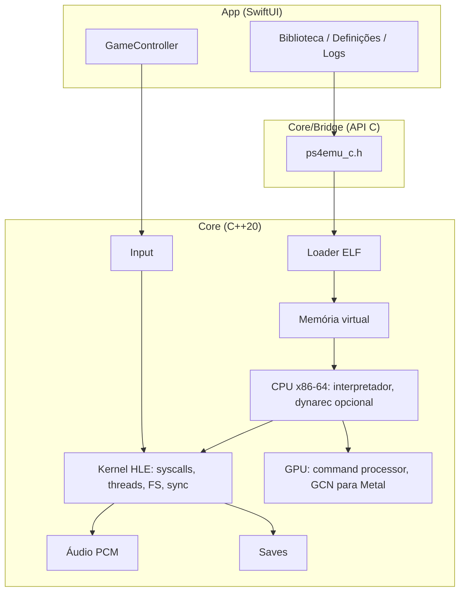

# ARCHITECTURE.md

## Visão geral

## Decisões
| # | Decisão | Motivo |
|---|---|---|
| 1 | Núcleo em C++20 puro, UI em Swift, ligação por **API C** | Menos atrito com Swift que Objective-C++ direto; núcleo testável em qualquer SO |
| 2 | **Testes do núcleo no host** (CMake + ctest, Linux/macOS) | Dá para validar sem iPad nem Mac |
| 3 | **XcodeGen + GitHub Actions** para gerar o IPA | Permite compilar sem ter Mac |
| 4 | IPA **sem assinatura**; assinatura pelo utilizador | Não envolve certificados no repositório |
| 5 | **Interpretador primeiro**; dynarec só na Fase 6 e só com JIT permitido | JIT é restrito no iPadOS |
| 6 | Loader aceita **ELF64 x86-64 simples**; rejeita SELF | Requisito legal (ver LEGAL.md) |
| 7 | Memória do guest **pequena e configurável** (começar em 256 MB) | O PS4 tem 8 GB; iPads com A16 têm 4 GB totais |
| 8 | Alvo mínimo iOS 16; testado em iPadOS 27 | Pedido original; evita exigir SDK novíssimo |

## Questão em aberto
Toolchains de homebrew podem produzir um contentor "SELF não assinado" em vez de ELF simples. Decidir na Fase 2 se se suporta *apenas o parsing do contentor* (sem qualquer criptografia) ou se se exige ELF simples. Por agora: ELF simples.

## Limites conhecidos
- Jogos comerciais estão fora de alcance (ver ROADMAP.md, "Expectativas").
- Sem JIT, o interpretador x86-64 é ordens de grandeza mais lento que o hardware original.
